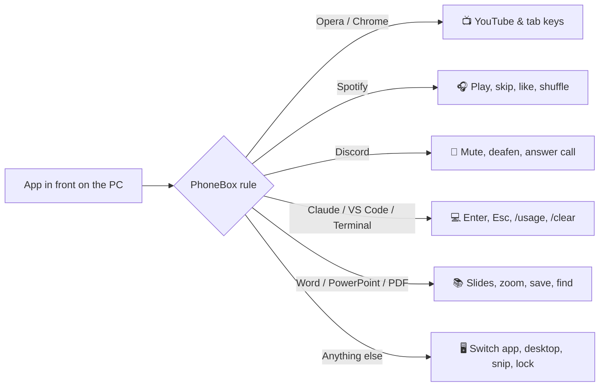

# 📱 PhoneBox Desk Setup

**I turned an old Android phone into a smart desk panel for my Windows PC.** It shows what I'm doing, tracks my
screen time and gives me buttons that change with the app I'm using.

Built by **[Tashfin Rahman](https://github.com/Tashfin-Rahman)** on top of
[PhoneBox](https://github.com/ersinkoc/phonebox), an open-source desk-panel app by ersinkoc.
This repo is **my own setup**: the pages, the app-aware Live buttons, the activity tracker scripts and the automation
rules. You can import it into your own PhoneBox.

> Hardware: realme RMX3834 on a stand (Android 15), Windows PC (i7-8700K), over Wi-Fi, so no cable to the PC.

---

## ✨ What I built

### 🖥️ App-aware Live page
The panel follows the app that's in front on my PC and swaps its 8 buttons to match, about a second after I switch apps.



### 👀 "Right now" activity tracker
A small PowerShell script ([`scripts/right-now.ps1`](scripts/right-now.ps1)) reads the window in front and shows it
on the panel:

```
📺 Watching
Full Finance Course - 11 Hour Video
```

Categories: 📺 Watching · 🎮 Playing · 💬 Discord / WhatsApp · 🎧 Spotify · 💻 AI & code · 📚 Studying · 🌐 Browsing ·
💤 Away (after 3 minutes with no mouse or keyboard input).

### 📊 PC screen time
[`scripts/today.ps1`](scripts/today.ps1) turns the tracker's log into a daily summary, like phone screen time
but for the PC:

```
YouTube      2 h 10 m
Coding & AI  1 h 05 m
Discord        45 m
----
Tracked today: 4 h 00 m
```

Privacy: it stores only the time and the app category (`17:12,YouTube`), in a local file
(`%LOCALAPPDATA%\PhoneBox\activity\`). Nothing is uploaded, and there are no screenshots or keystrokes.

### 📄 All 17 pages

| Page | What's on it |
|---|---|
| 🏠 Home | Clock, Dhaka weather, now playing, CPU / GPU / RAM / ping, Claude usage rings, "Right now" |
| 🖥️ Live (+5 app versions) | Right now, now playing, today's screen time, open windows, app-aware buttons |
| 📚 Study | Pomodoro 25/5, daily task checklist, exam note, time progress, break timer |
| 🎮 Gaming | GPU details, CPU+GPU graph, ping, launch Discord / Opera GX / Spotify |
| 🎧 Game deck | Push-to-talk, panic mute, Discord mute/deafen, clip last 30 s, soundboard |
| ✳️ AI work | Claude usage, Claude Code sessions, Start Claude Code / usage buttons |
| 📊 System · ⚙️ Processes · 🎛️ Shortcuts · 🎵 Music | PhoneBox defaults, lightly tuned |
| 🌙 Night | Analog clock, word clock, moon phase |

### 🤖 Automation rules

| When… | Then… |
|---|---|
| Claude Code needs my input | Jump to **AI work** |
| CS2 / FC25 / FC26 runs for 10 s | Jump to **Gaming** |
| 7–10 pm, Sunday to Thursday | Show **Study** |
| I switch apps on the PC | Show that app's **Live** buttons |
| Away 10 min, or 11:30 pm–7 am | Show **Night** |
| CPU above 90 % or the internet is slow | Notification on the panel |

Claude Code permission prompts (Allow / Deny) also appear on the phone.

---

## 🚀 Use it yourself

1. Install [PhoneBox](https://github.com/ersinkoc/phonebox) on your PC and phone (see [docs/phone-setup.md](docs/phone-setup.md)).
2. Edit `PC_USER` at the top of [`config/build_config.py`](config/build_config.py), then run:
   ```
   python config/build_config.py
   ```
3. Open `http://127.0.0.1:8765` → Settings → Advanced, paste in
   [`config/phonebox-config.json`](config/phonebox-config.json), and click **Apply JSON** → **Save**.

Tested on PhoneBox **0.9.14**. Change the button keys, app names and study hours to fit your own setup.

## 📚 Guides
- [Phone setup flowchart](docs/phone-setup.md): USB debugging, Wi-Fi, realme battery settings
- [Wi-Fi troubleshooting](docs/wifi-troubleshooting.md): the firewall and Public/Private network fixes I needed
- [Phone as a webcam](docs/webcam.md)

## 🙏 Credits
- [PhoneBox](https://github.com/ersinkoc/phonebox) by ersinkoc (MIT): the app this setup runs on.
- Built with help from Claude.

MIT License © 2026 Tashfin Rahman
