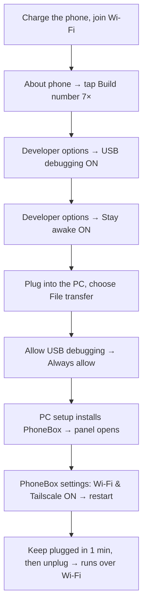

# Phone setup



## Where USB debugging is on Android 15

| Brand | Unlock developer options | Developer options |
|---|---|---|
| Pixel / stock | About phone → Build number | System → Developer options |
| Samsung | About phone → Software information → Build number | Bottom of main Settings |
| Xiaomi / Redmi / POCO | About phone → OS version | Additional settings → Developer options |
| realme / OPPO / OnePlus | About device → Version → Build number | System (or Additional settings) → Developer options |

Tip: search "USB debugging" in Settings. On Xiaomi phones, also turn on *Install via USB* and *USB debugging (Security settings)*.

## PC setup (Windows)

Paste into a normal PowerShell window (not as administrator):

```powershell
irm https://raw.githubusercontent.com/ersinkoc/phonebox/main/setup.ps1 | iex
```

## realme / OPPO: stop the app being killed

Long-press PhoneBox → App info → Battery → **Allow background activity**.
